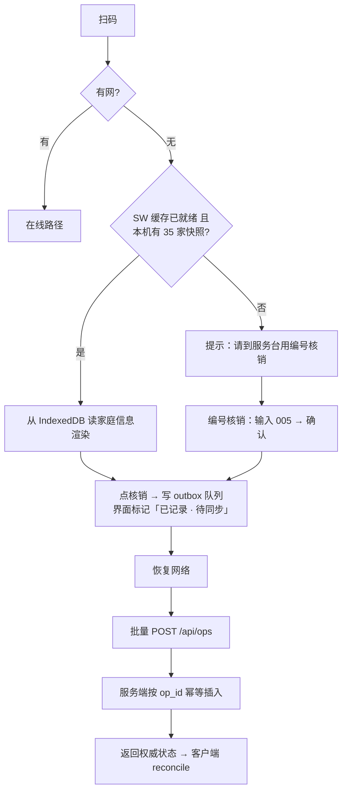

# Retro Village 村民服务站 · 设计文档

> **历史文档（2026-10-23 起）**：电子村民卡、二维码和工作人员核销流程已退役，现场签到与礼品领取改为纸质签字表。当前实现与接手说明以 [`HANDOFF.md`](HANDOFF.md) 和 [`../README.md`](../README.md) 为准；本文仅保留早期设计取舍与实现记录。

| 项 | 内容 |
|---|---|
| 版本 | v0.4（复古露营视觉改版 + 实现验收通过） |
| 日期 | 2026-10-21 |
| 项目 | 一月一露 · 西郊林场 · Retro Village 复古露营 |
| 规模 | 约 35 个村民家庭 |
| 参考 | `docs/reference/guide-book.pdf`（丹尼提供，营地指南 2 页） |

---

## 0. 评审修订记录（v0.2 → v0.3）

v0.2 经三份独立交叉评审（H5/微信兼容、后端数据一致性、现场产品可用性），结论均为「修完再开工」。以下是**已采纳的改动**，后文均已同步。

### 0.1 推翻的原有设计（4 处，改动最大）

| 原设计 | 改为 | 原因 |
|---|---|---|
| 核销用**长按 0.6s** 确认 | **单击 + 5 秒底部撤销 toast** | 撤销已存在，长按是重复投保；湿屏/汗手/电容手套会触发 `touchmove` 让进度环归零；iOS 微信原生 callout 阈值约 500ms，0.6s 等于每次和系统抢手势 |
| `/staff` 以**扫码**为主路径 | 以**「未签到清单」点一行**为主路径，扫码降为辅助 | 真实动作是「在 35 家里定位这一家」；清单上点一行 1–2 秒且不用对焦，比举相机扫纸卡快 |
| 邻居由**营位号字符串推导** | **营位号 + 区内序号**；邻居名仅当 `map.json` 提供邻接关系时才显示 | A5→A4/A6 只在「每区一排顺序号」时成立；显示错邻居会让村民围着别人的帐篷扎营，比不显示更糟 |
| 离线可**扫码核销** | 离线只承诺**编号核销 + 名单搜索核销** | iOS Safari / 主屏 PWA **没有 `BarcodeDetector`**，也无法在应用内调相机扫码，该验收项永远无法通过 |

### 0.2 修正的错误结论（6 处）

| # | 原说法 | 事实 |
|---|---|---|
| 1 | 分享封面靠 `og:image` | 无公众号时微信取**页面第一张真实渲染的 ``**（≥300px 宽，`display:none` 不算）；`og:image` 非官方行为，多数版本忽略 |
| 2 | SW 注册在 `/staff/` scope 只拦 `/staff/*` | scope 外的 `/assets/*`、`/styles.css` **根本不会被拦**，预载必然失败。改为**根 scope 注册 + `fetch` 里按路径分流** |
| 3 | 两个存储上下文（微信 vs 系统浏览器） | 实际是**三个**：微信内置浏览器 / Safari / 主屏 standalone PWA 的 cookie、IDB、SW **全不共享**。登录与预载必须都在**主屏 PWA 内**各做一次 |
| 4 | `INSERT OR IGNORE` 做幂等 | 它**也忽略 NOT NULL / CHECK / UNIQUE 违反**。非法 `type` 会被静默丢弃，客户端却收到「已处理」→ 静默丢写。改为 `ON CONFLICT(op_id) DO NOTHING` + 显式校验 + 三态响应 |
| 5 | 冲突检测：存在更早记录则标记 | **非对称**：设备时钟偏快、后同步但事件时间更早时不标记 → 库里两条有效记录且都不标冲突。改为**对称检测** + 数据库部分唯一索引兜底 |
| 6 | 以 `client_at` 最早者为权威 | 时钟可被手改；且 `datetime('now')`（空格分隔）与 `toISOString()`（`T` 分隔）**字符串比较是错的**（空格 0x20 < 'T' 0x54）。改为**服务端自增 `seq` 定权威**，时间统一 **epoch ms 整数** |

### 0.3 补上的缺失（8 处）

1. **HTML 缓存头**：`/v/*`、`/staff*`、`/api/*` 一律 `no-store`，否则安卓微信秒开旧页面（「已签到」显示成「未签到」→ 重复核销）。
2. **ops 唯一性由数据库强制**：`state` 字段 + `CREATE UNIQUE INDEX ... WHERE state='effective'`。
3. **合并动作的 op 扇出**：「签到+领礼」必须写两条 op，共用 `op_group_id`，撤销按 group 单事务执行。
4. **离线撤销**：outbox 加状态机 `pending/sent/confirmed/voided`，撤销未同步 op 走「先发后撤」，不直接删队列（否则会永久固化误操作）。
5. **admin 独立凭证**：`staff.role` + 独立 PIN。原设计「同一 PIN + 独立路径」意味着任何员工 cookie 都能拉 35 家手机号。
6. **会话可吊销**：cookie 带 `session_version`，每个鉴权请求回查 `active/session_version/role`；登录接口限速。
7. **导出两层**：家庭派生视图恒 35 行（staff 可用）+ 原始流水（admin）。补 `sync-status` 接口做「本机还差几条没传」——原设计承诺「未同步 op 在导出里标注」是服务端做不到的。
8. **现场风险**：天气/下雨（纸卡淋湿是单点物理载体）、服务器单点、电量与人手、活动时长未定义。

### 0.4 v0.4 视觉改版（复古露营）

初版是「牛皮纸档案 / 票根」的文具感，与露营气质不符。v0.4 整体改为**复古露营**语汇：Hudson's Bay 四色条纹、遮阳篷条纹封面、帆布织纹底、搪瓷营地牌、营地徽章。调色板与四个核心元素见 §8.1。

同时修掉实现阶段测出的问题（均已验证）：

| 问题 | 后果 | 修法 |
|---|---|---|
| `postOps` 用旧快照回写 outbox | 连续快速核销时**丢 op** | 重新读队列，只改动本次发出的那批（`sentIds`） |
| `BASE_URL` 未校验 | 生产忘设 → 打印出 35 张 **localhost 二维码**，且静默无报错 | 生产环境 localhost 直接 `process.exit(1)`；`/healthz` 报 `baseUrlOk`；打印页红条警告 |
| 清单页 7 秒自动 reload | 连续核销被打断、滚动位置丢失 | 只在详情页 reload |
| `resolveConflict` 的 `void` 分支 | 把已撤销的记录**复活** | 校验 `state` 与 `resolved_ms` |
| 离线同步后页面不刷新 | 服务端已签到、页面还写「未签到」 | 用 `/api/ops` 返回的 `authoritative` 直接刷界面（**不 reload**） |
| 反馈等 IndexedDB 写完 | 首次点击 ~500ms 才闪屏 | 先闪屏/置灰/改状态，再落盘 → **17ms** |
| 组撤销把「本来就已撤」也计入 | 计数语义错 | 拆 `changed` / `already` |

### 0.5 补上的验收（§19 拆三份）

`软件验收`（原内容）+ **`物理验收`**（泡水/揉皱/贴歪/1 米外读编号/工牌套）+ **`流程验收`**（纸质兜底、换机、拿错卡、共享平板、次补签到）+ **一次 30 分钟无提示彩排**。

---

## 1. 一句话定位

每家门口的一张二维码，就是这次活动的全部说明书。
村民扫码看到「我是谁、我在哪、我该做什么」；工作人员扫同一个码，完成签到与礼品核销。

---

## 2. 背景与约束

### 2.1 已知事实

- 活动地点：一月一露西郊林场（松江区西茹路 1 号）。
- 村民家庭 ≈ 35 家，每家发 1 个专属二维码，纸质卡片。
- 已有素材：丹尼的 GUIDE BOOK（营地内 3 处设施 + 周边酒店与住宿推荐）。丹尼还会再写一份营地 TIPS 文档，之后导入。
- 现场网络状况**不确定**，按「随时可能断网」设计。
- 托管在**香港**（无备案域名），面向大陆访问。
- 村民礼品**统一 1 份/家**，不按人数递增。
- 主要场景是**微信内打开**：扫码进入，以及村民把页面**转发**给同行的家人/朋友。

### 2.2 硬约束

| 约束 | 影响 |
|---|---|
| 主要场景是**微信内打开 / 转发** | 首屏必须服务端直出；分享卡片标题要**按家庭个性化**（微信抓 HTML 源码，不执行 JS） |
| 工作人员用**手机微信扫码**核销 | 手机优先，首屏 1 秒内看到「这是谁、要做什么」 |
| 现场可能**断网** | 核销必须能离线完成并事后同步，不能出现「码扫开了但点不动」 |
| 35 家、1–2 个核销点 | 不需要高并发架构，但必须**防重复核销**和**误点可撤销** |
| 村民是普通用户，不是员工 | 零学习成本，不要登录、不要输入、不要"下一步" |
| 香港服务器、无备案域名 | 无需等待备案（**最大排期风险已消除**）；但需自己解决大陆访问速度，见 §15.2 |
| 礼品 1 份/家 | 核销不涉及份数计算，按钮只需「领了/没领」两态 |
| 必须 HTTPS | 微信内 http 会提示不安全；用 Caddy 自动证书，零成本 |

### 2.3 设计原则

1. **一张码，两个视角。** 不印两种码、不做两个入口。村民看到服务，工作人员看到操作台。
2. **离线只在需要的地方做。** 村民端是纯阅读，SSR 直出不依赖 JS，断网只是刷新不了——没必要上 Service Worker；离线能力集中投给工作人员的核销环节。
3. **分享出去也是一等公民。** 村民转给家人后，卡片要能看出是谁家、点开要能看出是什么页面，不能出现一排相同的「村民服务站」。
4. **核销动作要快，但不能快错。** 一屏一动作，大按钮 + 唯一清晰确认点。
5. **所有内容可后台改，代码里不写死活动信息。**
6. **不做需要村民「学习」的功能。** 没有账号、没有密码、没有表单。
7. **可撤销优于防误。** 误操作的恢复成本接近 0 时，不要再为「防误」加一个会拖慢每一次操作的确认步骤。

### 2.4 「主要在微信内」意味着什么

这不是一句部署说明，它直接改了三处设计：

| 影响点 | 具体后果 |
|---|---|
| **分享卡片** | 微信为链接生成卡片时抓取的是 HTML 源码里的 `<title>` / `og:*` / 首图，**不执行 JS**。所以村民页必须服务端渲染，且 title 要带家庭名 → 详见 §8.6 |
| **转发即传播** | 村民把链接转给家人，家人打开看到同一张家庭卡（同一个 token）。这是**期望行为**，但要保证 URL 里没有任何敏感字段，且分享公共页时不要带 token |
| **无 Service Worker 依赖** | 微信内 SW 不可靠（§12.4）。村民端不装 SW 也能 100% 使用；离线核销只承诺在工作人员的独立 PWA 里 |

---

## 3. 角色

| 角色 | 设备 | 认证方式 | 权限 |
|---|---|---|---|
| **村民** | 自己的手机（微信扫码，或点家人转发的链接） | 持有专属 token URL | 只读：自己的家庭卡、地图、TIPS、公约 |
| **工作人员** | 自己手机（微信扫同一张卡）/ 平板 | PIN 码 → 设备记住 30 天 | 签到、礼品核销、撤销、现场查人 |
| **管理员（你/丹尼）** | 电脑 | 同一 PIN + 独立路径 | 名单维护、卡片打印、地图标注、数据导出 |

---

## 4. 现场时间轴（决定功能优先级）

```text
活动前            │ 入场 0–3h         │ 活动中           │ 结束
─────────────────┼───────────────────┼──────────────────┼──────────────
· 导入 35 家名单  │ ★ 扫码签到        │ · 查营位/找邻居   │ · 导出 CSV
· 打印 35 张卡片  │ ★ 领村民礼品      │ · 看 TIPS/公约    │ · 复盘数据
· 工作人员预载    │ · 找自己营位      │ · 查周边吃饭      │ · 沉淀名单资产
  离线包          │ · 「我没来过，   │                  │
· 手机真机演练    │    要注意什么」   │                  │
```

**最高频 = 入场 3 小时内、站在服务台前的 30 秒。** 所有设计围绕这 30 秒。

---

## 5. 功能范围

### P0 · 必须（本次活动上线）

| # | 功能 | 说明 |
|---|---|---|
| F0 | **服务台待办清单** | `/staff` 首屏默认「未签到」列表，按编号排序、可按 A/B/C 区切换，每行一键「签到+领礼」。**这是现场主路径**，扫码与编号输入都是辅助 |
| F1 | 村民签到 | 工作人员扫码 → 确认到营 → 落库；重复扫码显示「已于 HH:MM 签到」 |
| F2 | 领取村民礼品 | 独立于签到；**统一 1 份/家**，两态（已领/未领）；支持「签到 + 领礼」一键合并 |
| F3 | 我的营位卡（个人主页） | 家庭名、营位号、区/排、左右邻居、签到与礼品状态、地图入口 |
| F4 | 营地 TIPS | 丹尼文档导入（Markdown），针对「第一次来一月一露的人」 |
| F5 | 村庄地图 | 点击营位看归属；个人页高亮自己的营位 |
| F6 | 村庄公约 | Markdown 内容页 |
| F7 | 卡片打印 | `/admin/print` 一键生成 35 张 A4 拼版，含二维码、编号、家庭名、营位号 |
| F8 | 工作人员离线核销 | 断网可核销，恢复网络自动同步，服务端幂等去重 |
| F9 | 工作人员总览 | 搜索家庭、手动兜底（村民没带卡）、进度统计、撤销 |

### P1 · 建议加（成本低、收益明确）——本次可选

| # | 功能 | 为什么值得 |
|---|---|---|
| F10 | 周边推荐页 | 丹尼文档已有内容，直接复用，村民一定会问「附近吃什么」 |
| F11 | 编号检索核销 | 卡片印大号 `001–035`，键盘输入编号即可定位——**离线唯一可用的扫码替代**，也常用于「找特定一家」 |
| F12 | 双人核销冲突可见 | 两台设备同时离线核销同一家时，后台标记冲突，事后对账 |
| F13 | 数据导出 CSV | 活动结束 5 分钟内拿到名单 + 签到时间，沉淀为下次活动资产 |

### P2 · 明确不做（防止范围膨胀）

- 账号体系、村民注册、手机号验证
- 支付、押金、订单
- 实时聊天、村民发帖
- 推送通知（微信内无法可靠推送）
- 精准室内定位 / GPS 导航（营地尺度不需要，且耗电、不准）
- 活动时间表 Timeline、村庄公告栏（你本次未选，见 §18 二期建议）

---

## 6. 信息架构与页面清单

```text
/                          入口页（村民扫错码时兜底 + 双入口说明）
│
├─ /v/:token                ★ 核心页：一张码两视角
│   ├─ 村民视角            家庭卡 + 营位 + 地图入口 + 内容导航
│   └─ 工作人员视角        识别到 staff session 时，顶部浮出核销操作条
│
├─ /v/:token/map           全屏地图（高亮自己营位）
├─ /map                    公共地图（可分享，不带 token）
├─ /tips                   营地 TIPS（丹尼文档）
├─ /charter                村庄公约
├─ /nearby                 周边推荐（GUIDE BOOK 第 2 页）
│
├─ /staff/login            工作人员 PIN 登录
├─ /staff                  总览 + 搜索 + 编号核销 + 撤销 + 进度
└─ /admin
    ├─ /admin/families     名单维护（增删改、导入 CSV）
    ├─ /admin/print        卡片打印
    ├─ /admin/map          地图营位坐标标注
    └─ /admin/settings     活动名称、日期、礼品名称、窗口时间
```

页面总数 9 个公开 + 4 个后台。**村民侧只有 6 个页面**，全部一屏或两屏内读完。

---

## 7. 关键流程

### 7.1 村民首次扫码（无感，0 操作）

```mermaid
flowchart LR
  A[微信扫卡片] --> B[/v/:token]
  B --> C{token 有效?}
  C -- 否 --> Z[友好提示：请联系服务台]
  C -- 是 --> D[渲染家庭卡]
  D --> E[顶部：欢迎回家<br/>老王一家 · A5 营位]
  E --> F[状态区：待签到 / 已签到 HH:MM]
  F --> G[下方：地图 / TIPS / 公约 / 周边]
```

> 村民侧**不需要点任何"签到"按钮**——签到由工作人员完成。村民只是看状态。这是刻意的：避免自助签到作弊，也避免村民在服务台前排队操作手机。

### 7.2 工作人员扫码核销（在线主路径）

```mermaid
flowchart TD
  A[工作人员扫同一张卡] --> B[/v/:token]
  B --> C{本设备有 staff session?}
  C -- 无 --> D[提示：以工作人员身份打开?]
  D --> E[输入 PIN 一次，本机记住 30 天]
  E --> F
  C -- 有 --> F[页面顶部浮出核销条]
  F --> G[显示：005 老王一家 · A5 · 3人<br/>签到/礼品两个状态]
  G --> H[一个自适应主按钮]
  H --> I[单击即落库<br/>按钮文案由当前状态决定]
  I --> L[整屏橄榄绿闪 + ✓ + 底部 toast]
  L --> M[toast 内 5 秒「撤销」<br/>状态区显示 14:32 · 小林]
```

**为什么单击而不是长按（v0.3 推翻原设计）：**

1. 撤销已经是防线（底部 toast 内 5 秒可撤），再叠一层长按是重复投保，却要向 70–100 次操作每次都征收一次持续按压。
2. 湿屏、汗手、电容手套会触发 `touchmove` / `touchcancel`，让长按进度环中途归零——**长按才是被这些条件惩罚的那一方**。
3. iOS 微信原生 callout 阈值约 500ms，0.6s 长按每次都在和系统抢手势，容易弹出「选择/复制」菜单。
4. 边说话时眼睛不在屏幕上，看不到进度环，工作人员会怀疑没按到而重按。

**防误靠三件事，不靠长按：** 自适应主按钮（只有一个清晰动作）+ 大点击区（≥56px）+ 5 秒撤销 toast。

### 7.3 离线核销（断网兜底）



### 7.4 编号核销（离线唯一可用路径）

扫码在 iOS 上无法离线使用（无 `BarcodeDetector`、PWA 内不能调相机），所以**编号与名单就是离线的主手段**。`/staff` 顶部常驻输入框，聚焦即弹数字键盘：

```text
┌─────────────────────────────┐
│  输入编号  [ 005        ] ✓ │
└─────────────────────────────┘
        ↓ 回车
┌─────────────────────────────┐
│  005 · 老王一家             │
│  A5 营位 · 3 人 · 礼品 1 份 │
│  ○ 未签到   ○ 未领礼品      │
│  [ 签到+领礼 ]  [ 仅签到 ]  │
└─────────────────────────────┘
```

**这条路径完全不依赖二维码和相机**，是「卡丢了 / 手机没网 / 扫码失败 / 老人机」的总兜底，也常常比扫码更快。

---

## 8. 界面设计

### 8.1 视觉规范（v0.4：复古露营）

**改版原因**：初版是「牛皮纸档案 / 票根」的文具感，跟露营气质不符。改成**复古露营**语汇——Hudson's Bay 毛毯条纹、遮阳篷条纹、帆布织纹、搪瓷营地牌。

```css
/* 主色 */
--ink:        #23301F;  /* 深森林墨：主文字 */
--ink-deep:   #16210F;
--kraft:      #4E6B47;  /* 中绿：小标签、副标题 */
--muted:      #5C6450;  /* 灰绿：说明文字 */

/* 帆布底 */
--paper:      #F2E9D7;  /* 帆布奶油：页面底 */
--paper-2:    #EADFC8;  /* 卡片底 */
--paper-3:    #DCCDAE;
--line:       #C6B493;
--line-soft:  #D9C9A8;

/* 露营四色（条纹与强调） */
--forest:     #2F4A34;  /* 森林绿：顶栏、主按钮、牌边 */
--forest-deep:#1F3324;  /* 深绿：页脚、工作台顶栏 */
--seal:       #A6402C;  /* 砖红：强调、已签名 */
--mustard:    #D9A227;  /* 芥末黄：待办、点缀 */
--navy:       #2F4858;  /* 靛蓝：条纹层次 */
--ok:         #3E6B3A;  /* 完成态 */
--warn:       #B4762A;  /* 待同步 / 冲突 */
```

**四个核心视觉元素：**

1. **四色条纹**（Hudson's Bay 式）——顶栏底边、页脚顶边、打印卡片顶部、营位牌顶部。统一写法：
   ```css
   border-image: repeating-linear-gradient(90deg,
     var(--paper) 0 14px, var(--navy) 14px 22px, var(--paper) 22px 30px,
     var(--seal) 30px 44px, var(--mustard) 44px 54px, var(--forest) 54px 70px
   ) 0 0 5px 0;
   ```
2. **帆布织纹**——body 两层极淡的 90°/0° 细线（`rgba(47,74,52,.028)` 1px/3px），像布面而不是白纸。
3. **搪瓷营地牌**——营位块：2.5px 深绿粗边 + 顶部 7px 条纹 + 四角铆钉 + 内凹双阴影。
4. **营地徽章**——替代原来的「印章」：森林绿圆环 + 砖红内环 + `RV`；深色底上自动反白（`.seal--on-dark`）。

**其余：**
- 中文用系统字体（`PingFang SC / HarmonyOS Sans / Microsoft YaHei`），数字与编号用 `Georgia` 等宽衬线。
- 圆角从 4px 提到 `6px`（标牌感），按钮加深色硬阴影 `0 2px 0 var(--forest-deep)` 做「按下沉」手感。
- 状态只有三种颜色：待办（芥末）/ 已办（橄榄绿 + ✓）/ 待同步（琥珀）。
- 分享封面（`cover.png`）是 800×400 的**垂直遮阳篷条纹**，在页面里作为第一张真实 `` 显示（微信抓它当卡片缩略图）。

### 8.2 村民页面（`/v/:token`）线框

```text
┌──────────────────────────────────┐
│  ⬤ RV  村民服务站          [地图]│  ← 48px 顶栏，纸色
├──────────────────────────────────┤
│                                  │
│   No.005                         │  ← 大号编号，等宽衬线
│   老王一家                        │  ← 28px 主标题
│                                  │
│   ┌────────────────────────┐     │
│   │  A5 营位                │     │  ← 营位块，最醒目
│   │  A 区 · 第 5 位 / 共 12 位│     │
│   └────────────────────────┘     │
│                                  │
│   ┌ 签到 ┐  ┌ 礼品 ┐             │
│   │ ✓ 已  │  │ ○ 待  │            │  ← 两枚印章式状态
│   │ 14:32 │  │ 1 份  │            │
│   └───────┘  └───────┘            │
│                                  │
│   ┈┈┈┈┈┈┈ 村庄指北 ┈┈┈┈┈┈┈┈      │
│   ▸ 营地地图              　　    │
│   ▸ 营地 TIPS（第一次来必读）     │
│   ▸ 村庄公约                     │
│   ▸ 周边吃饭与住宿                │
│                                  │
│   有问题？找服务站 · 小林          │  ← 底部常驻，工作人员可配
└──────────────────────────────────┘
```

设计要点：

- **首屏必须看到「家庭名 + 营位号 + 两个状态」**，无需滚动。
- 营位块是村民最想要的信息，视觉权重仅次于家庭名。
- **不显示邻居姓名。** 「A5 的邻居是 A4/A6」只在每区一排顺序号时成立，推错会让人围着别人的帐篷扎营。只显示「A 区 · 第 5 位」，这是从营位号可确定推导的事实。邻居名仅在 `map.json` 提供显式邻接关系时出现。
- 底部「找服务站 · 小林」是可配置的联系人，比"客服"有人情味。

### 8.3 工作人员核销条（浮在村民页顶部，`/v/:token` + staff）

```text
┌──────────────────────────────────┐
│ ← 返回        工作人员模式  [退出]│
├──────────────────────────────────┤
│  005 · 老王一家      （家长：王建国）│  ← 家长名只在这里出现，防拿错卡
│  A5 · A区第5位 · 3 人 · 礼品 1 份  │
│                                  │
│  ✓ 签到 14:32 小林               │  ← 两个状态同时显示，缺一不可
│  ○ 礼品 待领取                    │
│                                  │
│  ┌──────────────────────────┐    │
│  │      领礼品               │    │  ← 自适应主按钮，56px 高
│  └──────────────────────────┘    │
│  只签到 · 撤回                     │  ← 次要动作降级为文字链
└──────────────────────────────────┘
```

**主按钮文案随状态自动变化，工作人员永远不需要选择：**

| 当前状态 | 主按钮 |
|---|---|
| 都没办 | `签到 + 领礼品` |
| 已签到、未领礼 | `领礼品` |
| 已领礼、未签到 | `签到` |
| 都办完 | 置灰，显示 `✓ 14:32 小林 / ✓ 14:35 小林` |

底部固定一行同时显示**签到与礼品**（原设计只显示签到，是「工作人员不知道哪个做了」的直接成因）。

- 成功反馈：整屏 200ms 橄榄绿闪 + `✓ 已签到`。
  - **震动只在安卓生效**：`navigator.vibrate(60)` 在 iOS / 微信 iOS 里**不存在**（不报错，但什么也不发生）。所以成功反馈的主信号必须是**视觉**（整屏色闪 + 大字 ✓），震动当锦上添花。
  - 不用 `alert()` / `confirm()`——微信内样式错乱且会被部分机型拦。
- 已完成的按钮变成不可点，文案改为 `✓ 14:32 小林`，**不隐藏**（工作人员需要确认"是他签的"）。
- 撤销仅 5 分钟内可用，撤销后回到待办态并记审计。

### 8.4 地图（`/map`、`/v/:token/map`）

- 素材：一张营位分布图（丹尼可提供手绘草图或航拍），转成 SVG。
- 交互：点营位 → 底部弹出该家庭名（隐私考虑：**只显示家庭名，不显示成员姓名/电话**）。
- 个人页进入时：自己营位脉冲高亮 + 自动定位到视口中心 + 「你在这里」标签。
- 无素材时的兜底：分区网格（A/B/C 区按序号排列的卡片阵列），仍能回答「我在 A 区第 5 位」。
- 标注工具：`/admin/map` 提供可视化点选，点击图片上位置 → 生成 `map.json` 坐标，避免手写坐标。

> ⚠️ **依赖项**：营位分布图素材（见 §17.3）。素材到位前用兜底网格，不阻塞开发。

### 8.5 卡片（物化设计）

竖版卡片 **90 × 130 mm**（名片 + 一点，能塞进信封、也能塞进工牌套）：

```text
正面                                背面
┌──────────────────┐   ┌──────────────────┐
│  ⬤ RV            │   │   村民服务站使用说明 │
│                  │   │                  │
│   No.             │   │  1 微信扫左侧二维码 │
│   005            │   │  2 找到你的营位     │
│                  │   │  3 到服务站找小林   │
│   老王一家        │   │     签到 + 领礼品   │
│   A5 营位         │   │                  │
│                  │   │  ┈┈┈┈┈┈┈┈┈┈┈┈┈┈   │
│  ┌────────┐      │   │  有问题找服务站      │
│  │ ▓▓▓▓▓▓ │      │   │  小林 138-xxxx      │
│  │ ▓ QR ▓ │      │   │                  │
│  │ ▓▓▓▓▓▓ │      │   │  一月一露 · 西郊林场 │
│  └────────┘      │   │  松江区西茹路1号     │
│  微信扫码打开      │   │                  │
└──────────────────┘   └──────────────────┘
```

- 二维码纠错等级 **H（30%）**，允许卡片折角、油污、贴歪。
- 编号 `005` 用 36px 以上，是「卡丢了也能核销」的保险。
- 打印：`/admin/print` 生成 A4 拼版。**90×130mm 的卡在 A4（210×297）上只能排 2 列 × 2 行 = 4 张/页**，35 张 = **9 页**，含裁切线，纸色可选用牛皮纸。
  - （早前版本写的「每页 6 张、6 页」是错的，已修正。若想省纸，卡片缩到 85×55mm 名片尺寸可排 6 张/页，但二维码会变小，不推荐。）

### 8.6 微信分享卡片（新增，因主场景而定）

村民把链接转给家人/朋友时，微信会生成一张卡片。**微信抓取的是 HTML 源码，不执行 JS**，所以：

| 位置 | 内容 | 技术实现 |
|---|---|---|
| 标题 | `老王一家 · Retro Village 村民服务站` | 服务端渲染时注入 `<title>` |
| 描述 | `A5 营位 · 一月一露西郊林场` | `<meta name="description">` |
| 封面图 | 一张 800×800 复古纸色封面（带 RV 印） | **页面第一张真实 ``**，src 绝对 HTTPS、宽 ≥300px；`og:image` 只作兜底 |
| 图标 | 站点 favicon（发到聊天里的链接左侧小图） | `<link rel="icon">` |

四个容易踩的细节（v0.3 修正：主机制不是 og 标签）：

- **无公众号时微信取「页面第一张有效渲染的 ``」**，不是 `og:image`。所以封面必须是真正的 ``，且必须是 DOM 里第一张——别让 logo、地图 SVG 排在它前面。
- **不能是 CSS `background-image`**，微信抓不到，卡片会变灰块。
- **不能 `display:none`**，隐藏元素不算「有效渲染」。
- 宽度 ≥ 300px 才会被当封面，所以做 800×800、压到 < 50KB。
- 卡片按 URL 缓存，改了家庭名不会立刻刷新——35 家规模接受，必要时换个 URL 重发。

两个降级方案（取决于有没有认证公众号）：

1. **无公众号（默认）**：靠上面四个标签，微信会自动排版。标题与封面能辨识即可，不可控但够用。
2. **有认证服务号**：接微信 JS-SDK，可自定义分享标题/描述/图（`onMenuShareTimeline` / `updateAppMessageShareData`）。需要公众号认证 + 在「JS 接口安全域名」里填这个域名（**香港域名也能填，不需要备案**）。

> 工程量提醒：方案 1 只是几个 meta 标签，M1 就做完；方案 2 需要你提供公众号主体并花半天配置。**建议先按方案 1 上线，分享效果不满意再接 2。**

分享卡片里**不出现**手机号、家长姓名、其他家庭信息。村民主动分享自己的卡是预期的，但公共页（TIPS / 地图 / 公约）不带 token，可以放心转给朋友。

### 8.7 微信内渲染的 5 个坑（实现时直接避开）

| 坑 | 表现 | 对策 |
|---|---|---|
| `100vh` 不准 | iOS 微信底栏遮住按钮 | **双声明** `height:100vh; height:100dvh;`（旧 X5 内核不认识 `dvh` 会整条丢弃）+ `env(safe-area-inset-bottom)`。全屏层直接用 `position:fixed; inset:0`，不依赖视口单位 |
| 输入框字号 < 16px | iOS 聚焦时页面自动放大，错位 | 输入框 `font-size: 16px` 起 |
| 键盘顶起 | 编号核销时确认按钮被盖 | iOS 键盘只触发 `visualViewport.resize`，不触发 `window.resize`。监听前者，把「输入框+确认」做成同一个底部 sheet，聚焦时 `scrollIntoView({block:'center'})` |
| 胶囊式滚动 / 橡皮筋 | 页面回弹，底部露出白底 | `overscroll-behavior: none` + `background` 设在 `html` |
| 点按高亮 | 安卓微信点击闪灰块 | `-webkit-tap-highlight-color: transparent` |
| 原生 callout | 长按/点按弹「选择·复制·识别二维码」 | `-webkit-touch-callout: none; user-select: none; touch-action: manipulation` |
| 微信字号设置 | 用户把字体调大后状态块溢出 | `-webkit-text-size-adjust: 100%; text-size-adjust: 100%`，状态块不设固定高度 |
| 系统菜单 | 右键/长按菜单 | `contextmenu` 里 `preventDefault()` |

字体必须**自托管并子集化**（只带用到的汉字），不要引用 Google Fonts——大陆访问慢且可能被阻，会直接拖垮首屏。

---

## 9. 技术架构

### 9.0 定调：这是一个 H5 网站，不是一个 SPA

既然主场景是微信内扫码/转发，那它本质上就是**一组 H5 页面**。因此：

> **全站单一产物：Hono + hono/html 服务端渲染，客户端只写少量原生 TS 模块。不引入 React / Vue。**

理由：

| 角度 | 说明 |
|---|---|
| 分享卡片 | 标题/描述必须服务端出（§2.4）——一上来就注定要 SSR |
| 首屏 | 微信内 SPA 先白屏再渲染，且 React 运行时占 ~45KB gzip；SSR 直出 HTML 首屏就是完整内容 |
| 产品形态 | 12 个页面、写多读少、无复杂局部状态——SPA 带来的收益抵不上体积 |
| 维护 | 一份产物、一个端口、一套样式变量、一种部署；不用管两套构建、两套路由 |
| 交互量 | 真正的交互只有：长按确认、编号输入、outbox 同步、撤销。这些用原生 TS 写反而更短 |

代价：工作人员端没有组件化框架。但它的界面是「列表 + 输入框 + 大按钮」，原生足以支撑；离线队列本来就要自己写，不依赖框架。

### 9.1 选型

| 层 | 选型 | 理由 |
|---|---|---|
| 渲染 | **Hono + `hono/html` 标签模板全站 SSR** | 首屏直出、分享卡片正确、零前端框架。用 `html` 标签模板而非 JSX：Node 的类型剥离不处理 JSX，用 JSX 就得多一层服务端构建 |
| 样式 | **原生 CSS（CSS 变量 + 容器查询）** | 不引 Tailwind 构建链；全站样式 < 20KB |
| 客户端交互 | **原生 TypeScript 模块**（约 4 个） | 长按、outbox、编号核销、撤销，共 < 15KB |
| 离线 | Service Worker（手写，不用 Workbox） | **只拦 `/staff/*` 与静态资源**，村民页完全不经 SW |
| 离线存储 | IndexedDB（`idb`） | 家庭快照 + outbox 队列 |
| 后端 | Hono + better-sqlite3 | 单进程单文件数据库，35 家规模零负担；同进程兼做 SSR |
| 部署 | 香港轻量云 1C1G + Caddy | 无需备案；延迟靠体积控制（见 §15.2） |
| 二维码 | `qrcode`（服务端出 SVG） | 打印清晰，无客户端抖动 |
| 内容 | Markdown + front-matter，启动时渲染并缓存 | 丹尼写完 md 直接丢进 `content/` |
| 构建 | esbuild（**仅**打包客户端 TS 与 SW） | 秒级构建，无 Vite 全家桶；服务端直接跑 TypeScript（`--experimental-strip-types`） |

### 9.2 性能预算（硬指标，超了就砍）

| 项 | 预算 | 测法 |
|---|---|---|
| 村民页 HTML（gzip） | **< 25KB**（内联关键 CSS） | `curl -H 'Accept-Encoding: gzip' -s -w '%{size_download}'` |
| 村民页 JS | **0KB**（纯 SSR 无交互） | 同上 |
| 工作人员页 JS | < 15KB gzip | 同上 |
| CSS | < 20KB gzip | 同上 |
| 字体子集 | < 45KB（woff2，只带常用汉字 + 拉丁） | `ls -lh` |
| 首屏完整渲染（4G 模拟） | **< 1.2s** | Chrome DevTools 4G Slow |
| 首页请求数 | ≤ 3（HTML + CSS + 字体） | Network 面板 |

字体策略：中文系统字体优先（`-apple-system, PingFang SC, HarmonyOS Sans, Microsoft YaHei`），**只在需要复古感的标题/编号上加载**一个自托管子集化的衬线字体（如 `Noto Serif SC` 的 100 字子集）。这样既有风格又不拖首屏。**绝对不引 Google Fonts**（大陆慢/被阻）。

### 9.3 仓库结构

```text
rvcamping/
├─ content/                 # 丹尼的内容，纯 Markdown
│  ├─ tips.md               # 营地 TIPS（待导入）
│  ├─ charter.md            # 村庄公约
│  ├─ nearby.md             # 周边推荐（GUIDE BOOK 第2页）
│  └─ settings.json         # 活动名、日期、礼品名、联系人
├─ data/
│  ├─ families.csv          # 35 家名单（唯一事实源）
│  └─ map.json              # 营位坐标标注
├─ public/                # 静态资源（CSS 构建产物 / 地图 / 字体 / 封面图）
├─ server/
│  ├─ index.ts              # Hono 入口 + 路由挂载
│  ├─ pages/                # 全部页面（hono/html 标签模板，含分享卡片 meta）
│  ├─ api/                  # /api/* 接口
│  ├─ db.ts                 # SQLite schema + migrations
│  ├─ ops.ts                # 幂等核销逻辑
│  ├─ auth.ts               # PIN + 签名 cookie
│  └─ content.ts            # Markdown 读取与缓存
├─ client/                  # 原生 TS（构建成 public/app.js）
│  ├─ longpress.ts          # 长按确认
│  ├─ outbox.ts             # 离线队列 + 同步
│  ├─ staff.ts              # 编号核销 / 搜索 / 撤销
│  └─ sw.ts                 # Service Worker（只拦 /staff/*）
├─ scripts/
│  ├─ import-csv.ts         # 导入 35 家名单
│  ├─ gen-cards.ts          # 生成卡片 HTML/PDF
│  └─ build.ts              # esbuild 打包 client
└─ docs/
   ├─ DESIGN.md             # 本文档
   └─ reference/guide-book.pdf
```

包管理器统一用 **npm**（Node 自带，少一层依赖）。

---

## 10. 数据模型

v0.3 关键修正：**时间统一用 INTEGER epoch ms**（原来 `datetime('now')` 的 `'2026-10-21 14:32:00'` 与 `toISOString()` 的 `'...T14:32:00.000Z'` 字符串比较是错的，空格 `0x20` < `T` `0x54`）；**「每家庭每类型只有一条有效记录」由数据库唯一索引强制**，而不是靠每处查询自觉。

```sql
-- 村民家庭
CREATE TABLE families (
  id           INTEGER PRIMARY KEY,
  code         TEXT UNIQUE NOT NULL,        -- '005'，卡片印刷编号
  token        TEXT UNIQUE NOT NULL,        -- 160bit base32，签发后永不重算
  display_name TEXT NOT NULL,               -- '王家小院'
  head_name    TEXT,                        -- '王建国'，仅工作人员视角可见
  party_size   INTEGER NOT NULL DEFAULT 2,
  kids         INTEGER NOT NULL DEFAULT 0,
  campsite     TEXT,                        -- 'A5'
  phone        TEXT,                        -- 仅 admin 导出
  note         TEXT,
  active       INTEGER NOT NULL DEFAULT 1,  -- 软删，永不 DELETE
  created_ms   INTEGER NOT NULL
);

-- 核销流水（内容列永不 UPDATE，状态列可变）
CREATE TABLE ops (
  seq          INTEGER PRIMARY KEY AUTOINCREMENT,  -- 服务端收到顺序 = 权威依据
  op_id        TEXT UNIQUE NOT NULL,        -- 客户端 UUID，幂等键，重试永不重生成
  group_id     TEXT,                        -- 「签到+领礼」一次动作共用
  family_id    INTEGER NOT NULL REFERENCES families(id) ON DELETE RESTRICT,
  type         TEXT NOT NULL CHECK (type IN ('checkin','gift')),
  actor_id     INTEGER REFERENCES staff(id),
  actor_name   TEXT NOT NULL,               -- 服务端从 session 填充，绝不收客户端传值
  device_id    TEXT,
  client_ms    INTEGER NOT NULL,            -- 设备时间，仅展示 + 时钟异常检测
  server_ms    INTEGER NOT NULL,            -- 权威时间
  state        TEXT NOT NULL DEFAULT 'effective'
                 CHECK (state IN ('effective','superseded','undone')),
  conflict     INTEGER NOT NULL DEFAULT 0,  -- 仅展示标记，权威看 state
  late_sync    INTEGER NOT NULL DEFAULT 0,  -- |client-server| > 10min
  resolved_ms  INTEGER,                     -- 冲突处置
  resolved_by  INTEGER REFERENCES staff(id),
  resolution   TEXT CHECK (resolution IN ('keep','void'))
);

-- 数据库层面强制「每家庭每类型最多一条有效记录」
CREATE UNIQUE INDEX ux_ops_effective ON ops(family_id, type) WHERE state = 'effective';
CREATE INDEX idx_ops_family ON ops(family_id);
CREATE INDEX idx_ops_group  ON ops(group_id);

-- 工作人员（role 区分权限，admin 用独立凭证）
CREATE TABLE staff (
  id              INTEGER PRIMARY KEY,
  name            TEXT NOT NULL,
  pin_hash        TEXT NOT NULL,
  role            TEXT NOT NULL DEFAULT 'staff' CHECK (role IN ('staff','admin')),
  session_version INTEGER NOT NULL DEFAULT 0,  -- ++ 即吊销该人全部 cookie
  active          INTEGER NOT NULL DEFAULT 1
);

CREATE TABLE settings (key TEXT PRIMARY KEY, value TEXT NOT NULL);

-- 登录限速（内存 + 落库双保险）
CREATE TABLE login_attempts (ip TEXT NOT NULL, ms INTEGER NOT NULL, ok INTEGER NOT NULL);
```

派生状态用**一个视图**，所有页面/接口/导出都读它，避免各处漏写 `WHERE state='effective'`：

```sql
CREATE VIEW v_family_state AS
SELECT f.id AS family_id,
       MAX(CASE WHEN o.type='checkin' THEN o.server_ms END)      AS checkin_ms,
       MAX(CASE WHEN o.type='checkin' THEN o.actor_name END)     AS checkin_by,
       MAX(CASE WHEN o.type='gift'    THEN o.server_ms END)      AS gift_ms,
       MAX(CASE WHEN o.type='gift'    THEN o.actor_name END)     AS gift_by
FROM families f LEFT JOIN ops o
  ON o.family_id = f.id AND o.state = 'effective'
GROUP BY f.id;
```

**撤销语义（明确写死，避免各自发挥）**：撤销一条 `effective` 记录 → `state='undone'`，**不自动把 `superseded` 提升为有效**。家庭回到未核销状态；如果确实做过，重新核销一次即可。

---

## 11. API

### 11.1 公开（无认证）

| 方法 | 路径 | 说明 |
|---|---|---|
| GET | `/api/v/:token` | 家庭卡。**永远剔除** phone / head_name / 其他家庭数据 |
| GET | `/api/map` | 营位 + display_name（公共页可分享，见 §13 隐私决策） |

### 11.2 工作人员（签名 cookie，`requireStaff`）

| 方法 | 路径 | 说明 |
|---|---|---|
| POST | `/api/staff/login` | `{pin}` → 按行比对 `pin_hash` 解出身份；限速 5 次/5 分钟 |
| POST | `/api/staff/logout` | 清 cookie |
| GET | `/api/staff/snapshot` | 35 家 + 状态 + settings（离线预载；**不含 phone**） |
| POST | `/api/ops` | 批量提交，**逐条返回**三态结果 |
| POST | `/api/ops/:opId/undo` | 单条撤销（5 分钟窗口，幂等） |
| POST | `/api/groups/:groupId/undo` | 按动作组事务性撤销（「签到+领礼」用这个） |
| GET | `/api/staff/summary` | **COUNT(DISTINCT family_id)**，不是 COUNT(*) |
| GET | `/api/staff/search?q=` | 编号 / 家庭名 / 家长名 |
| GET | `/api/staff/conflicts` | 未处置冲突列表 |
| POST | `/api/staff/conflicts/:opId/resolve` | `{resolution:'keep'\|'void'}` |
| GET | `/api/staff/sync-status?device_id=` | 返回服务端已有 op_id 集合 → 客户端求差集得知「本机还差几条」 |
| GET | `/api/staff/export.csv` | **一家庭一行，恒 35 行** |

### 11.3 管理员（独立 admin 凭证，`requireAdmin`）

| 方法 | 路径 | 说明 |
|---|---|---|
| GET/POST | `/api/admin/families` | 全量含 phone；增改 |
| POST | `/api/admin/families/import` | CSV 导入 |
| POST | `/api/admin/families/:id/rotate-token` | 卡外泄时重签（需重印该张） |
| GET/POST | `/api/admin/settings` | 活动信息、礼品名、联系人、窗口 |
| GET/POST | `/api/admin/map` | `map.json` 读写 |
| POST | `/api/admin/ops/backfill` | **纸质签到表补录**（服务端故障时的兜底） |
| GET | `/api/admin/export-ops.csv` | 原始流水（含 undone/superseded/conflict） |

### 11.4 `POST /api/ops` 幂等与冲突（v0.3 重写）

原设计的 `INSERT OR IGNORE` + 「只标记新插入那条」有两个 P0 缺陷：`OR IGNORE` 会连 `CHECK` 违反一起吞掉（非法 op 静默丢失），且冲突检测是**非对称**的（时钟偏快的设备后同步时漏标）。

```text
POST /api/ops  body: [{ op_id, group_id?, token, type, client_ms, device_id }]
→ 200 [{ op_id, status: 'accepted'|'duplicate'|'rejected',
         reason?, conflict, state, authoritative: {...} }]
         ↑ 三态都要带 authoritative，否则 duplicate 分支客户端清不掉本地乐观状态

服务端逐条处理，整批包在一个事务里：
  1. 显式校验 type ∈ {checkin,gift} / token 存在 / client_ms 为整数
     → 不通过：status='rejected'，reason 说明，**不写库**
  2. INSERT INTO ops(...) VALUES(...) ON CONFLICT(op_id) DO NOTHING
     → changes=0 且 op_id 已存在：status='duplicate'（重放安全，撤销不会被覆盖）
  3. 冲突检测（对称）：该 (family_id,type) 是否已有一条 state='effective'？
     → 有：本行 state='superseded', conflict=1
     → 无：本行 state='effective'
     （与时间先后无关。谁来当有效记录只看 seq：**先被服务端收到的赢**）
  4. 若 |client_ms - server_ms| > 10 分钟 → late_sync=1（设备时钟可疑，展示用）
```

**权威判定**：`seq` 最小 = 服务端最先收到 = 权威。`client_ms` 只用于展示与时钟异常提示，**绝不用于排序或算撤销窗口**。撤销窗口按 `server_ms` 算。

---

## 12. 离线方案（本文档最关键部分）

### 12.1 分层降级

| 状态 | 村民侧 | 工作人员侧 |
|---|---|---|
| 在线 | 全功能 | 全功能 |
| 断网 + 已预载 | 缓存内容可读（TIPS / 公约 / 自己家庭卡） | **编号核销 + 名单搜索核销** + outbox（**不支持扫码**，见 §12.4） |
| 断网 + 未预载 | 提示「请连 Wi-Fi 后刷新」 | 提示「到服务台用平板核销」 |

### 12.2 预载（活动前 ritual）

工作人员到场后在 Wi-Fi 下打开 `/staff` 并点「预载离线包」：

1. Service Worker 预缓存 `/staff` 及其静态资源（目标 < 300KB gzip）。
2. `GET /api/staff/snapshot` → 写入 IndexedDB（35 条 ≈ 10KB）。
3. 预渲染 TIPS / 公约 / 地图 SVG。
4. 校验：显示「离线就绪 ✓ 35 家 · 资源 v1.2.3」，**失败则红色阻断提示**。

### 12.3 outbox 队列

```ts
type Op = {
  opId: string;        // crypto.randomUUID()
  token: string;
  type: 'checkin' | 'gift';
  clientAt: string;    // ISO，设备时钟
  deviceId: string;    // 从 localStorage 生成的设备指纹
};
```

**本地状态机（v0.3 新增，解决「撤销一个还没同步的 op」）：**

```text
pending ──发送──> sent ──200 confirmed──> confirmed（出队）
   │                │
   │                └── rejected ──> rejected 独立区（红标，不重试，不阻塞后面）
   └── 用户撤销 ──> voided（**标记但不删**，随后照常发送，再调 undo）
```

- `op_id` 在**入队时生成一次**，重试永不重生成（否则幂等失效）。
- 撤销 `pending` 的 op：标记 `voided` → 立刻触发同步把它发出去 → 拿到结果后紧接着调 `/api/ops/:opId/undo`。**不能只从队列里删掉**——如果这批其实已经发出、只是响应丢了，删队列会让误操作永久固化。
- 撤销 `confirmed` 的 op：直接调 undo 接口（幂等，重复调用返回 200 + 当前状态）。
- 入队即写 IndexedDB（**不靠 `beforeunload`**，iOS 微信左滑返回不保证触发）。
- 触发同步：`online` 事件、进入 `/staff`、每 60s、手动下拉。
- 重试退避 2s/5s/15s/60s；`rejected` **不参与重试**（否则一条坏 op 会阻塞队头 30 条）。
- 服务端返回 `authoritative` 后覆盖本地乐观状态；冲突项进「待核对」区。

### 12.4 微信内置浏览器的坑（重要工程结论）

微信内置浏览器的 Service Worker 注册在部分机型（尤其 iOS 微信、部分 X5 内核）不稳定或不可用。而本次**主场景就是微信内打开**，所以：

> **村民端不承诺离线，也不需要离线。** 村民页是 SSR 直出，首屏不依赖 JS；断网时只是刷新不了，已打开的页面照常阅读。这样反而卸掉了最脆弱的一环。
>
> **离线承诺只给工作人员端的独立 PWA。**

落地策略：

1. **SW 注册在根 scope，但在 `fetch` 里按路径分流**：只对 `/staff/*` 和 `/assets/*` 调 `respondWith`，其余（含 `/v/*`）直接 `return`，让浏览器正常走网络。这样村民页的缓存行为与服务端一致，而 staff 的静态资源能被预缓存。（v0.3 修正：原写「注册在 `/staff/` scope」是错的——scope 外的 `/assets/*` 根本不会被拦，预载必然失败。）
2. 工作人员**首次上岗前**用 Safari/Chrome 打开 `/staff` → 添加到主屏幕 → 用 PWA 图标操作。
3. 微信内打开 `/staff` 且处于离线时，明确提示：「离线模式需要系统浏览器，请点右上角「…」→ 在浏览器中打开」。
4. 二维码永远用微信扫没问题——**在线路径在微信内 100% 可用**，离线只是兜底。
5. 同时保留**编号核销**，它在任何浏览器、任何网络下都工作，是最后一道防线。

### 12.5 双上下文登录（容易被忽略的坑）

实际是**三个**隔离的存储上下文：**微信内置浏览器 / Safari / 主屏 standalone PWA**。cookie、localStorage、IndexedDB、SW 注册全不共享。所以：

| 场景 | 在哪里登录 | 靠什么认证 |
|---|---|---|
| 微信扫码核销（在线） | 微信内置浏览器，输 PIN 一次 | 服务端签发的 cookie |
| PWA 核销（含离线） | 系统浏览器/PWA，**需再输一次 PIN** | cookie + IndexedDB 里的会话副本 |

**离线时 PIN 怎么校验？** 服务端联系不上，所以 PWA 首次在线登录成功时，额外把「PIN 的本地哈希（PBKDF2 + 随机盐）」和会话到期时间存进 IndexedDB。之后：

- 在线：走服务端校验（权威）。
- 离线：本地哈希比对，通过则放行，所有 op 带同一个 `device_id`，联网后由服务端再校验会话是否仍有效。
- 本地哈希泄露也无法反推 PIN（PBKDF2 高迭代），且它只能用于本地离线核销，不能拿去调接口。

> 上岗 checklist 因此是三条：**① 微信里扫一张测试卡，确认能在线核销；② 从主屏图标打开 PWA，输一次 PIN；③ 在 PWA 内点「预载离线包」，看到「离线就绪 ✓ 35 家」。**
>
> **③ 必须在主屏 PWA 里做，不能在 Safari 里做完再添加到主屏**——那是两个库，会白屏 + 掉登录。

### 12.6 冲突与对账

- 两台设备离线核销同一家 → 都本地成功。同步时**先被服务端收到的**（`seq` 小）为 `effective`，后到的为 `superseded` + `conflict=1`，与设备时钟无关。
- `/staff` 顶部「⚠ 2 条冲突」→ 点开列表 → `keep`（保留现有）或 `void`（改判后到的为有效）→ 写 `resolved_ms/by/resolution`，徽标才会消失。**这个闭环原来缺失，冲突徽标会永久不消失。**
- **导出不会自动发现未同步的记录**——服务端对它从没收到的东西零知识。所以：导出前每台设备必须先跑 `sync-status` 到「0 条待同步」，否则 CSV 会安静地少几行，比标错更危险。
- 导出文件头带水印行：`# 导出时间 · 服务端已收 op N 条 · 以下仅含已同步记录`。

---

## 13. 安全与防误

| 风险 | 对策 |
|---|---|
| token 被猜到 | 160bit base32 随机，不可枚举；签发后永不重算；可 `rotate-token` 重签 |
| token 出现在外链 referer | `/v/*` 一律 `Referrer-Policy: no-referrer`（nearby 页有酒店/餐厅外链） |
| token 进访问日志 | 日志中 `/v/<token>` 只记前 8 位 + `…` |
| **`/map` 的隐私边界** | **显式决策**：`/map` 可分享、逐营位显示 `display_name`，即「35 家的家庭名↔营位」对任何持链接者可见。熟人露营场景**接受**此取舍。别再声称它受保护——错误的承诺比没有承诺更糟 |
| 村民看到别人信息 | token 只返回本家庭卡；地图不显示成员姓名/电话 |
| 手机号泄露 | `phone` 永不进入公开 API 响应，仅 admin 导出 |
| 工作人员手机丢了 | `active=0` 或 `session_version++` 即刻吊销（**每个鉴权请求都回查**，不是只验签）；快照不含 phone/head_name。**但本地 IDB 快照无法远端清除**，且快照必含 token→family 映射（离线查人靠它）→ 丢一台手机 = 35 张家庭卡可读 |
| admin 权限过大 | admin 用**独立凭证**；`/api/admin/*` 走 `requireAdmin`；原设计「同一 PIN」等于任何员工 cookie 都能拉 35 家手机号 |
| 登录爆破 | 4–6 位 PIN 只有 10⁴ 空间 → 登录限速 5 次/5 分钟，失败落库可查 |
| 邻居信息展示 | 只显示 `display_name`（本来就印在卡上），永远不显示 `head_name` |
| 误点核销 | 自适应单主按钮 + ≥56px 点击区 + 5 秒撤销 toast + 全程审计 |
| 代签刷礼品 | 签到与礼品分离记录、双人核销冲突可见、导出后人工对账 |
| 二维码被转发 | 无解也没必要防（35 家熟人场景）；风险由「工作人员现场确认」兜住 |

**不做**：HTTPS 以外的一切加密、验证码、风控。场景不匹配。

---

## 14. 内容导入流程（配合丹尼）

丹尼只需交付 **Markdown**，不需要碰代码：

```markdown
---
title: 营地 TIPS
subtitle: 第一次来一月一露，看这一页就够
updated: 2026-10-25
---

## 到达之前
正文……

## 关于用电
正文……
```

导入步骤：

1. 丹尼把 `.md` 丢进 `content/tips.md`（或发给你，你放进去）。
2. `npm run content:check` 校验：标题层级、图片路径、超长段落。
3. 重新构建部署（或 dev 模式热更新）。
4. 首页/个人页自动出现入口，无需改代码。

`content/nearby.md` 可从 GUIDE BOOK 第 2 页直接改写为结构化卡片（酒店 / 机场 / 三家餐厅 / 隐藏彩蛋烧饼），这里丹尼的内容已经完整，**不需要新写**。

---

## 15. 部署

### 15.1 方案

| 项 | 方案 |
|---|---|
| 服务器 | 香港轻量云 1C1G（阿里云香港 / 腾讯云香港轻量，带 30Mbps 峰值即可） |
| 线路 | 优先选带**大陆优化 / CN2** 的机型；不套 Cloudflare 免费代理（大陆回源路由差，反而变慢） |
| 域名 | 新注册一个干净域名（香港无需备案），如 `retrovillage.xxx` |
| HTTPS | Caddy 自动申请 Let's Encrypt 证书，**必须 HTTPS**（微信内 http 会提示不安全，且部分 JS API 不可用） |
| 进程 | `node server/index.js`，pm2/systemd 守护，Caddy 反代 :3000 |
| 数据库 | `data/app.db` 单文件，每小时 `sqlite3 .backup` 到本地 |
| 备份 | 活动前一天 + 每天 02:00 快照，活动当天每小时 |
| 监控 | 极简 `/healthz` + 你手机上的 Uptime 检查 |
| **DNS** | 用 DNSPod / 阿里云 DNS（**别用域名商默认的海外 NS**，解析就几百 ms），活动前 TTL 降到 60s，提前一天实测移动/联通/电信三家 |
| **缓存头** | `/v/*`、`/staff*`、`/api/*` → `Cache-Control: no-store`；静态资源带内容 hash → `immutable, max-age=31536000` |

### 15.2 香港托管的两个真实代价

不备案是省下来的时间，但换来两件事，已在设计里消化：

| 代价 | 对策 |
|---|---|
| **延迟** 大陆→香港：电信/联通 CN2 约 30–80ms，移动线与晚高峰常见 80–200ms 且伴 1–5% 丢包 | 首屏总字节压到 **< 150KB**；村民页 SSR 无 JS。目标改为**真机 + 大陆 SIM 的 P50 < 2s**（原写 1.2s 不现实，且 DevTools 的 4G 预训练不出跨境路径） |
| **微信风控** 新域名首次被大量转发时，偶发提示“即将离开微信”或风险提示 | 用干净新域名（不用被举报过的旧域名）；页面无诱导分享、无外链跳转；提前用 3–5 台不同手机实测分享 |

> 如果活动当天发现访问明显慢，应急方案是临时把一个静态镜像（内容页）放到大陆对象存储；但核销写库仍指向香港。不建议为此提前备案——除非活动要连续办好几天。

**离线访问的隐藏前提**：页面首次必须在有网时加载过一次（SW 才能缓存）。所以「预载」不是可选项，是上岗 checklist 的一项。

---

## 16. 排期

| 阶段 | 内容 | 工作量 |
|---|---|---|
| M1 | 骨架：Hono + SQLite schema + 35 家 CSV 导入 + 全局样式/设计 token | 0.5 天 |
| M2 | 村民页 SSR（含分享卡片 meta）+ 卡片打印 `/admin/print` | 0.5–1 天 |
| M3 | 工作人员：PIN、核销、长按确认、撤销、编号核销、总览 | 1 天 |
| M4 | 离线：SW（只拦 /staff）、快照预载、outbox、双上下文登录、冲突 | 1–1.5 天 |
| M5 | 地图（分区网格 + 标注工具）+ TIPS/公约/周边内容页 | 0.5–1 天 |
| M6 | 真机联调（微信 / PWA / 飞行模式 / 双设备）+ 修 bug | 0.5–1 天 |
| M7 | **30 分钟无提示彩排**：5 人扮村民、1 人扮工作人员，不给说明，只看 5 家能否 3 分钟内办完 | 0.5 天 |
| | **合计** | **5–6 个工作日** |

关键路径是 **M4（离线）** 和 **M6/M7（联调 + 彩排）**，不要压缩。

**M6 是技术联调，M7 是流程演练，两回事。** 彩排是唯一能在活动前发现「其实不用扫码更快」「工作人员不知道点哪」「卡拿混了怎么办」的手段，性价比高于任何单项技术测试。

原本最大的不确定项（域名备案）已经因为香港托管而消失，**现在可以直接开工**。

---

## 17. 风险与待确认

### 17.1 ✅ 已定：香港托管，不备案

原风险（大陆备案周期 3 天–3 周且不受控）已通过香港部署消除，**不再阻塞排期**。剩下的是延迟与微信风控，已在 §15.2 给出对策。

需你提供：**一个干净的新域名**（建议跟活动同名，好记、好口播）。

### 17.2 🟡 现场网络实测

「按没网设计」已覆盖最坏情况，但仍需实测确认：
- 4G/5G 信号强度（哪个运营商强）
- 场地是否有可用 Wi-Fi、密码、覆盖范围
- **建议**：活动前 1 天到现场用手机飞行模式 + 关闭飞行模式各跑一遍。

### 17.3 🟡 营位分布图素材（阻塞 F5 地图）

Neil 还没画完，已确认之后提供。需要：营位总平面图（手绘草图可，能辨认 A/B/C 区与编号即可）。

**不阻塞开发：** 先按分区网格上线（仍能回答「我在 A 区第 5 位」），素材到位后只需在 `/admin/map` 点选标注坐标，不动业务代码。

### 17.4 🟡 35 家名单字段

最低需要：家庭名、营位号、人数。可选：家长姓名、手机号、孩子数、特殊需求。
**请确认名单来源**（微信群接龙？报名表？），以及谁负责最终敲定。

### 17.5 ✅ 已定：礼品统一 1 份/家

不按人数递增，核销只需两态（已领/未领）。`party_size` 仅用于后台统计和工作人员现场核对。

### 17.6 ✅ 已定：2 台设备按区分段，不按职能分台

原方案「签到台 + 礼品台」会让每家跑两个台、排两次队。改为**按营位区分段**（A 区 001–012 / B+C 区 013–035），提前公告「A 区的排左边」。冲突标记是兜底，不是计划。**卡片何时到村民手上**仍需你确认（见 §17.11）。

### 17.7 🔴 天气 / 下雨（原文档完全没写）

十月下旬松江下雨是常态，不是意外。纸卡淋湿后二维码会糊，**纠错 H 也救不了水**。

- 卡必须**过塑 + 工牌套**（§8.5 的 90×130mm 本来就是照工牌套尺寸定的）。
- 服务台备雨棚/大伞；所有印刷品备用密封袋；礼品用防水袋。
- 现场流程加一条：雨天优先走**编号核销**（卡湿了扫不出来，编号还看得见）。

### 17.8 🔴 服务器单点故障（原文档完全没写）

香港 1C1G、单进程、单 SQLite，无 HA。它一挂：35 个村民页全打不开，而所有离线兜底都终止在「另一台已预载设备」上——**没有一条终止在纸上**。

- **必须准备**：打印好的 35 行纸质签到表 + `/admin/ops/backfill` 补录入口。
- 活动当天每小时备份 `app.db` 到本地。

### 17.9 🟡 电量与人手

入场 3 小时屏幕常亮 + 相机，电量是硬约束。**备 2 个充电宝**；新人替班时给一张**打印的一页上岗卡**（三条 checklist + PIN + 编号输入位置）。

### 17.10 🟡 活动时长未定义

本文默认**单场一天**。若跨夜，outbox 记录会在某台手机里过一夜，手机没电就等于丢账——此时 §17.8 的纸质兜底从「保险」升级为「必需」。

### 17.11 🟡 卡片交付方式未定（影响整个入场流程）

卡片是「提前寄到村民手上」还是「入场时工作人员从一叠里翻找发放」？前者村民自带（会忘带/淋湿），后者工作人员要找卡（20–40 秒/家 + 发错卡风险）。**这一句不定，§7.2 的流程就没有依据。** 建议：随欢迎包提前给，入场只扫码/报编号。

---

## 18. 二期建议（本次不做，但值得记下）

1. **活动时间表 Timeline** — 纯静态、成本极低、现场被问最多的问题之一。你本次未选，但强烈建议在 P1 后补。
2. **村庄公告栏 / 广播** — 一条「雨要来了收帐篷」能救很多帐篷。需要极简发布后台（一个输入框）。
3. **服务台求助入口** — 冰块、充电、丢东西、身体不适 → 该找谁。能显著降低工作人员的重复解答。
4. **活动后记忆页** — 结束后同一个码变成「你的第一次 Retro Village」相册/数据回顾，二维码从工具变成纪念品。
5. **名单复用到下次活动** — 单次活动不建 `event` 表；但 `families` 与核销流水已拆开，下次可直接复用名单、清空 `ops` 即可。

---

## 19. 验收清单（活动前必须全绿）

v0.3 拆成三份：**软件验收 / 物理验收 / 流程验收**。原文档只有第一份，而「软件全对、现场还是乱」的典型来源全在后两份。

### 19.1 软件验收

**村民侧**
- [ ] 35 张卡全部扫码，均正确显示对应家庭名与营位号
- [ ] 手机首屏（iPhone 12 / 安卓 6.1" / **平板**）无需滚动即可看到家庭名 + 营位 + 两个状态
- [ ] 用户把微信字体调到最大，状态块不溢出、不挤压
- [ ] TIPS / 公约 / 周边 三个内容页微信内可读，图片不超出屏幕
- [ ] 地图可点选营位，自己营位高亮清晰
- [ ] 点按/长按页面**不弹系统「选择/复制/识别二维码」菜单**

**工作人员侧**
- [ ] `/staff` 首屏默认就是「未签到」清单，点一行即可核销
- [ ] 主按钮文案随状态自动变化（4 种状态各验一次），不会重复写 op
- [ ] 底部一行**同时**显示签到与礼品的时间 + 操作人
- [ ] 家长姓名在核销条可见（防拿错卡）
- [ ] 微信内与主屏 PWA **各登录一次**都能用（§12.5 三个上下文）
- [ ] PWA 离线状态下 PIN 能登录（本地哈希校验）
- [ ] 单击即落库 + 5 秒撤销 toast；撤销后状态回退
- [ ] iOS 上成功反馈靠视觉可确认（`navigator.vibrate` 在 iOS 不存在）
- [ ] 重复核销不重复入库，显示「已于 HH:MM 签到」
- [ ] 撤销在 5 分钟内有效、超过 5 分钟失效
- [ ] 编号核销 `005` 回车 → 正确弹出家庭
- [ ] 冲突徽标能通过 `keep/void` 处置**消失**（不是永久挂着）

**离线（飞行模式）**
- [ ] 预载后断网，用**编号**核销 3 家 → 成功 → 显示「待同步」
- [ ] 离线状态下**点撤销**一个未同步 op → 恢复网络后该记录最终为已撤销（不是被固化）
- [ ] 断网 10 分钟后恢复 → 自动同步成功 → 待同步标记消失
- [ ] 两台设备同时断网核销同一家 → 恢复后一条为 `superseded`、`COUNT(DISTINCT family_id)` 仍为 1
- [ ] 提交一条非法 op（坏 type）→ 返回 `rejected`，库中 0 行，**客户端不删该 op**
- [ ] 断网且未预载 → 出现明确可操作提示（不是白屏）
- [ ] `sync-status` 跑完显示「0 条待同步」，且与导出 35 行一致

**微信内与分享（主场景）**
- [ ] 用 3 台不同手机（iPhone / 华为 / 小米）微信扫码，均不白屏、字不挤、按钮不遮
- [ ] 转发单个家庭链接，卡片标题显示「XXX · 村民服务站」而不是统一标题
- [ ] 卡片封面是页面**第一张真实 ``**（不是 CSS 背景、不是 `display:none`），≥300px
- [ ] 好友点开能看到同一张家庭卡，布局不错乱
- [ ] 转发公共页（TIPS / 地图）链接里**不带 token**
- [ ] 微信内关闭再打开，状态是最新的（`no-store` 生效，不是缓存的旧页面）
- [ ] 页面无「诱导分享」「打开 APP」类提示触发微信拦截

**数据**
- [ ] `/api/staff/export.csv` 恒 35 行，与现场记录一致
- [ ] 文件头水印行含导出时间与已收 op 数
- [ ] 数据库备份文件可正常恢复

### 19.2 物理验收

- [ ] 卡片**过塑 + 装进工牌套**，塞得下不折角
- [ ] 泡水 30 秒后擦干仍能扫出（不能过：说明必须走编号核销预案）
- [ ] 揉皱、贴歪 15°、边缘剪偏 2mm 后仍能扫出
- [ ] **1 米外**能读出三位编号
- [ ] 裁切线打印对齐，裁完不切到二维码
- [ ] 夜间/帐下弱光下，手机能扫出

### 19.3 流程验收

- [ ] **纸质兜底演练**：用打印的 35 行签到表 + 纸笔完成一次核销，再用 `/admin/ops/backfill` 补录进去
- [ ] **换机演练**：工作人员手机没电，换一台设备后未同步记录的去向清楚（`sync-status` 能报出差额）
- [ ] **拿错卡演练**：故意用小王的卡核销小李，看工作人员能否靠「家长姓名」发现
- [ ] **共享平板演练**：两人轮流用同一台设备，操作人归属是否正确
- [ ] **次日补签到**：模拟第二天才到的家庭，能正常核销且导出能区分
- [ ] **礼品发完**：显示「已领 23 / 35 · 库存 12」，并有话术（登记、稍后补）
- [ ] **30 分钟无提示彩排**：5 人扮村民、1 人扮工作人员，不给任何说明，看 5 家能否 3 分钟内办完

---

## 20. 附：决策记录与剩余待确认

### 已确认（2026-10-21）

| 项 | 决策 | 影响 |
|---|---|---|
| 架构 | 轻量全栈自建；**单一 H5 产物，全站 SSR + 原生 TS** | Node + SQLite 单进程；无前端框架 |
| 托管 | **香港，不备案** | 排期风险消除；改为控制体积与延迟 |
| 网络 | 按可能断网设计 | 离线核销 + 编号兜底 |
| 二维码 | 纸质卡片 + 工作人员微信扫 | `/admin/print` 出 35 张 |
| 礼品 | 统一 1 份/家 | 核销只两态，不算份数 |
| 主场景 | **微信内扫码 + 转发** | 村民页改 SSR，新增分享卡片设计（§8.6） |
| 营位图 | Neil 之后提供 | 地图先降级为分区网格 |
| 核销交互 | **单击 + 5s 撤销**（v0.3 推翻长按） | 不再和微信原生 callout 抢手势 |
| 现场主路径 | **未签到清单点一行**（v0.3） | 扫码降为辅助 |
| 设备分工 | 2 台**按区分段**，不按职能分台 | 每家只跑一个台 |
| 离线承诺 | **仅编号/名单核销**，不承诺扫码 | iOS 无 BarcodeDetector |
| 时间基准 | **服务端 `seq` 定权威**，时间统一 epoch ms | client 时钟不可信 + 格式混用会排错 |

### 20.2 实现与文档的已知偏差

| 项 | 文档写的 | 实际实现 | 原因 |
|---|---|---|---|
| 模板 | `hono/jsx` | `hono/html` 标签模板 | Node 的 `--experimental-strip-types` 不处理 JSX；用 JSX 需要多一套服务端构建 |
| 数据库驱动 | better-sqlite3 | `node:sqlite`（Node ≥22.5） | better-sqlite3 需原生编译，`npm` 新版默认拦 install script；内置模块零依赖 |
| 事务 | `db.transaction()` | 手写 `BEGIN/COMMIT/ROLLBACK` | `node:sqlite` 没有 `transaction()` 辅助 |
| 工作人员身份 | 一个共享 PIN | **每人一个 PIN**（`staff` 表逐行比对） | 「✓ 14:32 小林」要归属到人，共享 PIN 做不到 |
| 离线扫码 | 曾计划支持 | **不做**，只承诺编号 + 名单 | iOS 无 `BarcodeDetector`（见 §0.1） |

### 还差你三个东西（都不阻塞开工）

1. **一个干净的新域名**（香港不备案，买个新的即可）——M1 部署时需要。
2. **35 家名单**：家庭名 / 营位号 / 人数（+ 可选家长姓名、手机、孩子数）——M1 能先跑假数据，真实名单最迟卡片打印前给。
3. **Neil 的营位图**——只影响 M5，来了就接。
4. **卡片怎么到村民手上**（§17.11）——这一句会改入场流程，越早定越好。

> 其余均无需等待，**M1 现在可以开工**。

---

## 21. 「需不需要服务端」：结论与取舍

这是被反复问到的问题，单独写一节说清楚。

### 21.1 结论

**保留服务端。** 但要说清楚它到底在为什么付费——它不是「因为要存数据所以必须有」，而是三件具体的事。

### 21.2 逐项拆解：什么是必须的，什么不是

| 能力 | 需要服务端吗 | 说明 |
|---|---|---|
| 村民看营位 / TIPS / 公约 / 地图 | ❌ 不需要 | 全部可预渲染成 35 个静态 HTML，分享卡片标题在构建时写死，微信抓取照样正常 |
| 签到 / 礼品核销的**记录** | ❌ 不需要 | 单机 IndexedDB + 活动后导出 CSV 就能完成 |
| 两台设备**实时互相看见** | ✅ 需要 | 纯静态下两台设备各记各的，只能事后人工合并 |
| 村民页显示**真实**签到状态 | ✅ 需要 | 纯静态下状态是构建时快照，村民看到的永远是「待签到」 |
| 后台改名单 / 打印卡片 / 导出 / 冲突对账 | ⚠️ 不必须但很省事 | 纯静态下这些要变成命令行脚本，非技术同学无法自助 |
| 服务器挂了怎么办 | — | 已有离线核销 + 纸质兜底表 + `/admin/backfill` 补录，**这条不是服务端的理由，而是它的代价** |

### 21.3 为什么最后还是选服务端

1. **状态要是真的。** 「村民扫码看到自己已签到」是这个产品的基本承诺。纯静态只能给一个构建时的假状态，等于砍掉一半价值。
2. **两台设备是既定方案。** §17.6 已定 2 台设备按区分段，纯静态下两人无法互相看见对方办的进度，现场会出现「这家好像办过了？」的反复确认。
3. **后台是给非技术同学的。** 名单导入、卡片打印、导出、冲突处置，做成页面比写成脚本的实际价值高得多——尤其丹尼要自己改内容。
4. **成本极低。** 香港 1C1G 一台机器 + SQLite 单文件，一年几十块到一两百块，35 家规模连负载都谈不上。

### 21.4 代价与已做的对冲

| 代价 | 对冲 |
|---|---|
| 多一个故障点 | 离线核销（outbox + 幂等同步）、纸质兜底表、`/admin/backfill` 补录、每小时备份 |
| 多一份运维 | 单进程 + Caddy + `pm2/systemd`，无外部依赖（连 better-sqlite3 都换成了 Node 内置 `node:sqlite`） |
| 香港跨境延迟 | 村民页 SSR 零 JS、首屏 < 150KB、字体子集化 |

### 21.5 如果将来真要退化到纯静态（B 计划）

不用重写，路径是现成的：

1. `scripts/` 里加一个 `prerender.ts`，启动时遍历 35 家，用同一套页面组件输出 `dist/v/<token>.html`。
2. 核销端把 `/api/ops` 换成「只写 IndexedDB」，同步逻辑保留但默认关闭。
3. 活动结束后用 `/api/staff/export.csv` 的同等格式，从各设备导出再合并。
4. 代价：失去实时互见与真实状态，后台功能降级为脚本。

> 换句话说：**服务端是为「实时 + 真实状态 + 非技术同学可自助」付的钱**，不是为「存 35 行数据」付的钱。这个规模完全付得起。
